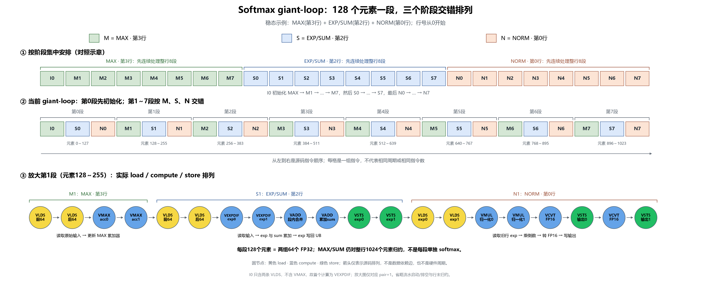

# Giant-loop 的 128 元素分段交错

[SVG 矢量图](giant_loop_interleaving.svg) · [源码核对记录](giant_loop_interleaving.json)

示例对应稳态外层 `pipe_i=3`：

- `M`：计算第3行的 MAX。
- `S`：计算第2行的 exp 和 sum，exp 写回 UB。
- `N`：从 UB 读取第0行的 exp，乘第0行的倒数，再转换为 FP16 写输出。

每行1024个元素分成8段，每段128个元素。
第0段是特殊的初始化段：`I0` 的两条 VLDS 直接把第3行前128个元素装入
`max_acc0/max_acc1`，不执行 VMAX。所以 steady loop 开头的首个计算指令是
S0 中的 VEXPDIF，然后进行 sum 初始化、exp 写回和 N0 归一化。

从内层 `pair=1` 开始才执行 VMAX 更新累加器，随后是 EXP/SUM 和 NORM。
`M1 → S1 → N1` 表示依次安排这三个不同行中元素128～255的指令；
接着安排 `M2 → S2 → N2`，即元素256～383的指令。

上方色块表示一组源码指令，大小不表示相同耗时。下方圆节点每个表示一条实际指令，
按稳态内层 `pair=1` 的源码顺序放大；圆间箭头只表示排列顺序，不是 DAG 依赖边。
实际是否重叠执行取决于数据依赖、forwarding 和硬件资源。

MAX/SUM 仍对整行归约，不是每128个元素单独计算 softmax。
图中 I0 明确表示首段初始化；放大图只对应 pair=1，不代表第0段的指令内容。
图省略流水启动和排空、行末归约，避免把循环组织和完整时序混淆。

源码：[8×1024 无 membar 完整 CCE](../runnable_a6/rows8/no_membar.cce)。
绘图脚本：`scripts/draw_softmax_giant_loop_schedule.py`，与图均位于 membar_results 目录内。
